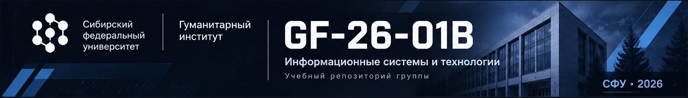

  

# GF-26-01B

Репозиторий учебной группы **ГФ26-01Б** Сибирского федерального университета.

Здесь собраны учебные материалы, доклады, рефераты, презентации и другие работы, подготовленные студентами группы в рамках дисциплины «Информационные системы и технологии».

## О проекте

Основная цель репозитория — организовать совместную работу над учебными материалами, упростить их подготовку и обеспечить централизованное хранение всех выполненных заданий.

Для подготовки текстовых работ используется **Typst** — система вёрстки документов, позволяющая создавать структурированные материалы с единым оформлением на основе шаблона СФУ.

Репозиторий также используется для совместной работы с Git и GitHub: распределения задач, контроля изменений и проверки готовых материалов.

## Структура репозитория

Материалы организуются по семинарам и темам, чтобы каждый участник мог быстро найти нужную работу.

- `seminar-01/` — материалы первого семинара.
- `seminar-02/` — материалы второго семинара.
- `seminar-03/` — материалы третьего семинара.
- `settings/` — дополнительные настройки и вспомогательные файлы.
- `README.md` — описание проекта и правила работы.
- `sibfu-template.typ` — шаблон оформления документов СФУ.
- `main.typ` — основной файл документа.

В папках семинаров могут находиться исходные файлы Typst, готовые PDF-документы, презентации и используемые материалы.

## Используемые инструменты

- **Git** — контроль версий и отслеживание изменений.
- **GitHub** — совместная работа, хранение материалов и проверка изменений.
- **Typst** — создание и оформление текстовых документов.
- **Markdown** — документация и вспомогательные материалы.
- **PDF / ODP / PPTX** — форматы готовых документов и презентаций.

## Правила совместной работы

Для поддержания порядка в репозитории используется следующая система:

1. Каждый участник работает в собственной ветке.
2. Изменения напрямую в `main` не отправляются.
3. Для каждой новой работы создаётся отдельная ветка по шаблону `feat/Фамилия-темаN`.
4. После выполнения работы изменения фиксируются отдельным осмысленным коммитом.
5. Готовая работа отправляется через Pull Request в ветку `main`.
6. Проверку и слияние изменений выполняет ответственный участник с правами Maintainer.
7. Для обсуждения вопросов, исправлений и распределения задач используются GitHub Issues.

**Важно:** готовые материалы необходимо добавлять в репозиторий не позднее чем за 12 часов до соответствующего семинара.

## Участие в проекте

В подготовке учебных материалов участвуют все студенты группы ГФ26-01Б.

Каждый участник отвечает за выполнение назначенной работы, корректность оформления и своевременное добавление материалов в репозиторий.

При внесении изменений необходимо соблюдать установленную структуру каталогов и правила работы с ветками.

---

**Сибирский федеральный университет**

Гуманитарный институт  
Группа ГФ26-01Б

2026
